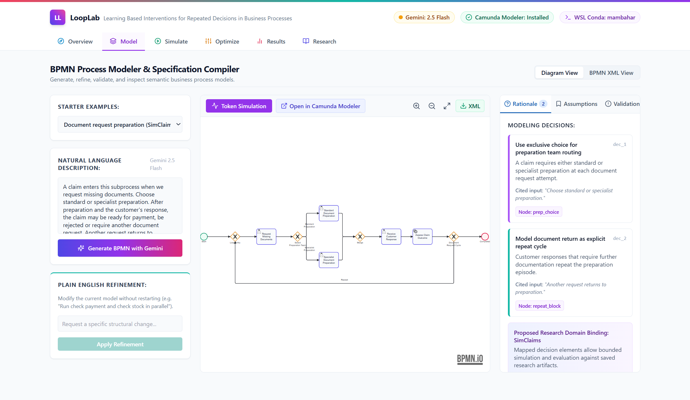
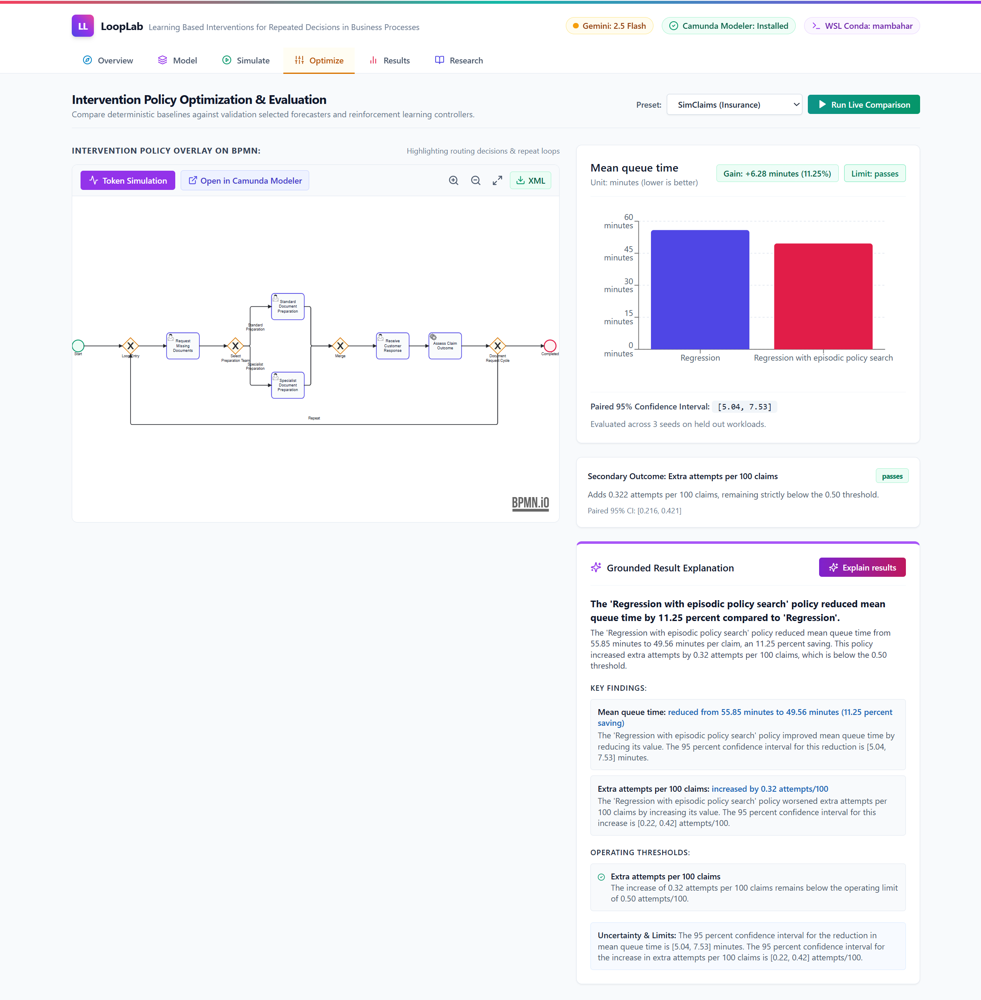

# LoopLab: Learning Based Interventions for Rework and Repeated Decisions in Business Processes:

LoopLab is an interactive research demonstration workbench for studying, modeling, simulating, and evaluating learning based control policies in cyclic business processes. It accompanies the research paper titled "Learning Based Interventions for Rework and Repeated Decisions in Business Processes".

## Visual Interface Overview:

The platform features a multi color design system with horizontal BPMN 2.0 visualization, live queue simulation, and grounded policy explanations:





For an in depth visual walkthrough across desktop, tablet, and mobile layouts, see [Visuals.md](Visuals.md).

## Research Problem and Motivation:

Modern business processes frequently feature repeated activities. These cycles originate from customer documentation requests, quality assurance rework, iterative negotiations, and multi round approvals. Conventional process models often treat repeated decisions as independent episodes, ignoring queue congestion and state buildup across loops.

LoopLab demonstrates how machine learning forecasters and reinforcement learning controllers can intervene at critical decision points to reduce turnaround times and queue backlogs while strictly respecting domain operating constraints.

## System Capabilities:

- Plain English Process Modeling: Users describe activities, branches, and repeat cycles in natural language. Gemini 2.5 Flash generates a structured process specification, records explicit modeling decisions, and produces standard OMG BPMN 2.0 XML with horizontal layout coordinates.
- Conversational Model Refinement: Users refine models through natural dialogue without restarting from scratch. The system updates the specification incrementally.
- Interactive Token Simulation: Browser based token execution powered by bpmn js token simulation allows researchers to observe token paths, gateway splits, and loop returns directly on the canvas.
- Calibrated Discrete Event Simulation: Replays empirical workload traces against a Python research engine, computing queue delays and case level traces.
- Policy Optimization and Ablations: Displays audited comparison charts for regression forecasts, episodic policy search, safety constrained search, and conservative Q learning with paired 95 percent confidence intervals.
- Grounded Natural Language Explanations: Gemini 2.5 Flash interprets policy gains, adverse tradeoffs, and uncertainty using strict evidence bundles with numeric citations rounded to two decimal places.
- Camunda Desktop Modeler Integration: A one click launcher opens active BPMN process models directly inside the installed Camunda Desktop Modeler application on Windows.

## Four Verified Research Domains:

LoopLab provides four pre calibrated simulation environments derived from real institutional data sources:

1. SimClaims (Document Request Preparation):
   - Setting: Insurance claim processing with missing document requests.
   - Decision Point: Routing between standard and specialist preparation teams.
   - Primary Metric: Mean queue wait time per claim in minutes.
   - Audited Result: Queue wait reduced from 55.85 minutes to 49.56 minutes. Gain is 6.28 minutes saved (11.25 percent reduction) with paired 95 percent confidence interval [5.04, 7.53].
   - Operating Limit: Additional preparation attempts remain below 0.50 per 100 claims (actual is 0.32 attempts per 100 claims, status passes).

2. BPISim (Incomplete Loan Application Review):
   - Setting: Loan processing based on the BPI Challenge 2017 event log.
   - Decision Point: Forced episodic review assignment at incomplete review markers.
   - Primary Metric: Total elapsed application turnaround in minutes.
   - Audited Result: Turnaround changes from 8,974.01 to 8,963.69 minutes. Gain is 10.32 minutes saved with interval [-3.55, 28.66], which crosses zero.
   - Finding: Active review work accounts for only 0.68 percent of total elapsed time. Validation protocol correctly retains the baseline regression controller.

3. SimFactory (Manufacturing Repair and Reinspection):
   - Setting: Batch production line with physical rework and reinspection loops.
   - Decision Point: Routing between standard and specialist repair teams using accrued wait states.
   - Primary Metric: Tail queue wait time (longest waiting jobs in an 80 job batch) in minutes.
   - Audited Result: Tail wait reduced from 688.88 minutes to 638.59 minutes. Gain is 50.29 minutes saved (7.30 percent reduction) with paired 95 percent confidence interval [33.69, 68.45].
   - Tradeoff: Extra repairs increase by 0.405 per 100 jobs with upper confidence interval bound 0.551 exceeding the 0.50 limit.

4. SimBank (Iterative Commercial Loan Negotiation):
   - Setting: Commercial loan interest rate negotiation across at most three rounds.
   - Decision Point: Rate selection (5 to 9 percent) using Conservative Q Learning (CQL).
   - Primary Metric: Customer refusal rate per 100 negotiations.
   - Audited Result: Refusals decrease from 25.04 to 19.29 per 100 negotiations. Gain is 5.75 fewer refusals (22.95 percent reduction) with paired 95 percent confidence interval [4.82, 6.85].
   - Tradeoff: Native profit changes by 6.92 units with interval [-67.93, 93.57], showing unresolved gain or loss.

## Architecture and Technology Stack:

- Front End: Next.js 15 App Router, React 19, TypeScript, Tailwind CSS, Lucide React, Recharts.
- Process Modeling: bpmn js, bpmn js token simulation, bpmn auto layout, custom horizontal DAG layouter.
- Large Language Model: Google Gemini 2.5 Flash via `@google/genai` with versioned system instructions and bounded repair loops.
- Research Microservice: FastAPI running Python 3.9 through 3.13, executing discrete event simulations and calibrated data adapters.
- Business Process Engine: Camunda Desktop Modeler version 5.x integration with Zeebe preparation pipeline.

## Quick Start:

### 1. Automated Installation:

On Windows, run the setup script from the repository root:

```cmd
setup.bat
```

Or with PowerShell:

```powershell
.\setup.ps1
```

### 2. Launch Services:

Start the Python research service and web application with one command:

```cmd
start.bat
```

Or with PowerShell:

```powershell
.\start.ps1
```

The web interface is available at `http://localhost:3000`. The Python research simulation service is available at `http://localhost:8000`.

## Testing and Reproducibility:

- Run the automated Playwright browser test suite:
```powershell
Set-Location "web"
npx playwright test
```
All seven tests validate overview card rendering, horizontal BPMN generation, token simulation, live workload simulation, and live Gemini API generation.

- Verify audited paper metrics:
```powershell
python scripts\verify_demo_results.py
```
The script verifies exact equality between the web manifest and the repository raw experiment logs.

## Documentation Index:

- [Usage.md](Usage.md): Stepwise user guide covering process modeling, simulation, policy optimization, and research auditing.
- [InstallationAndSetup.md](InstallationAndSetup.md): Prerequisites, automated setup, and troubleshooting manual.
- [CodeBaseIndex.md](CodeBaseIndex.md): Directory layout, contract interfaces, and architectural layer guide.
- [Visuals.md](Visuals.md): Visual walkthrough, branding palette, and responsive viewport captures.
