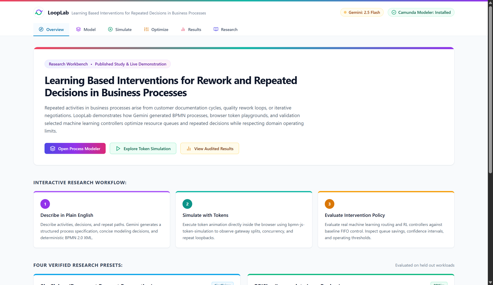
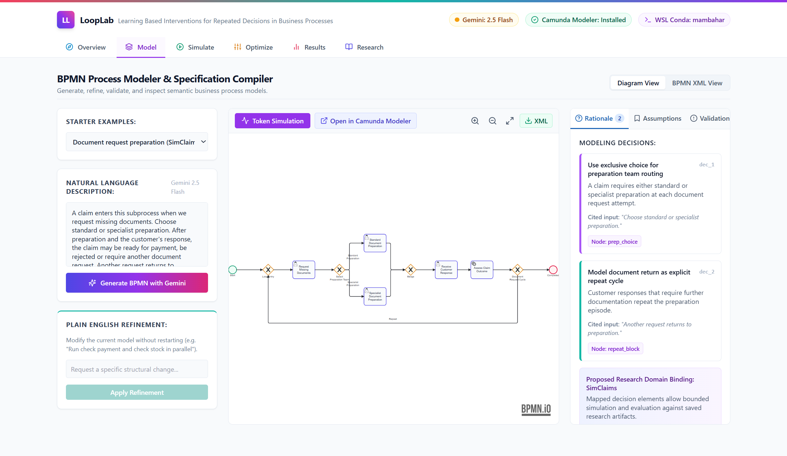
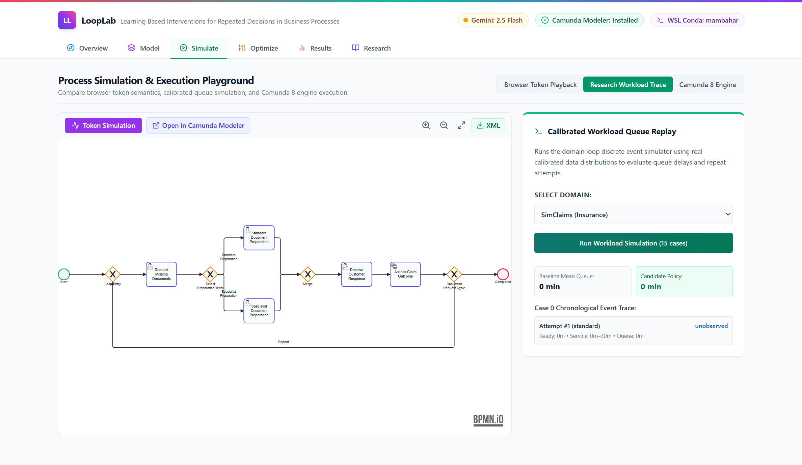
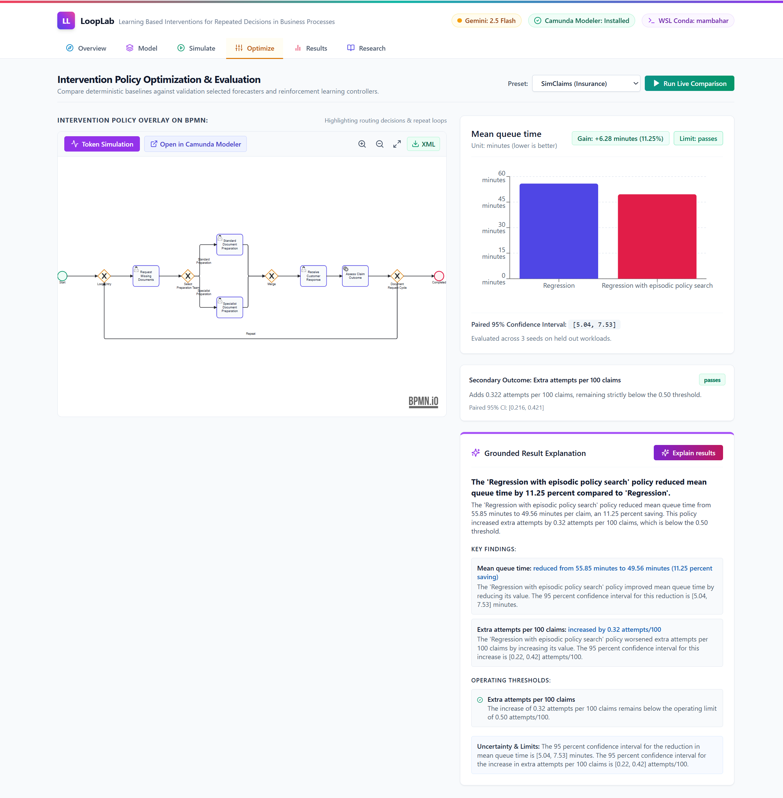
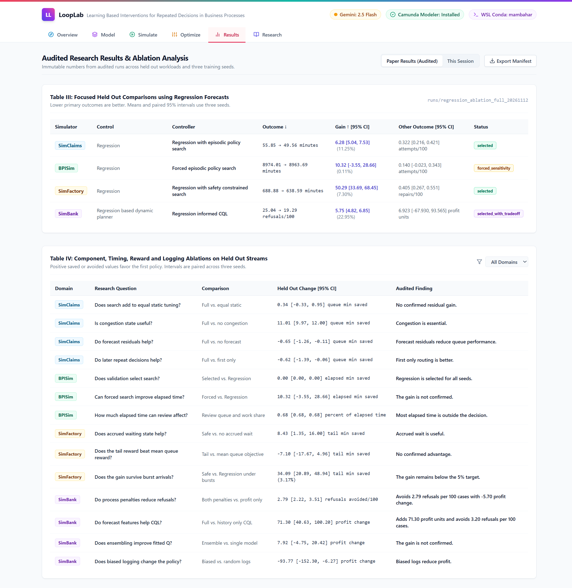
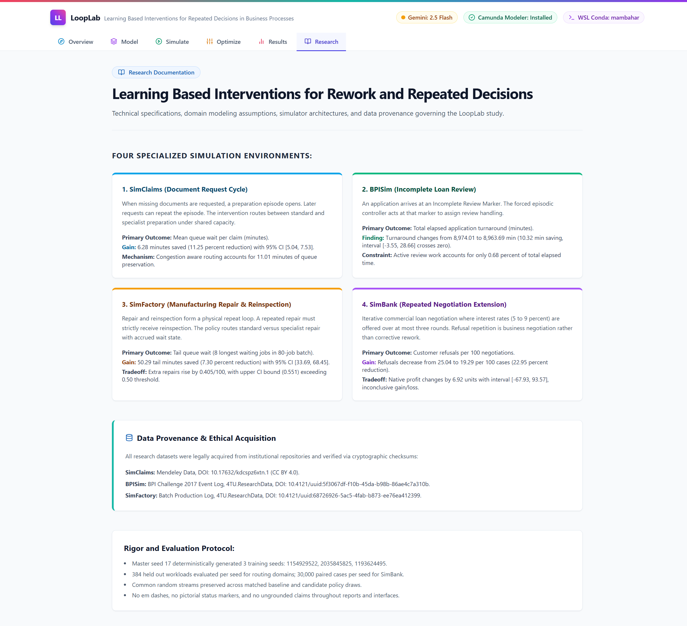
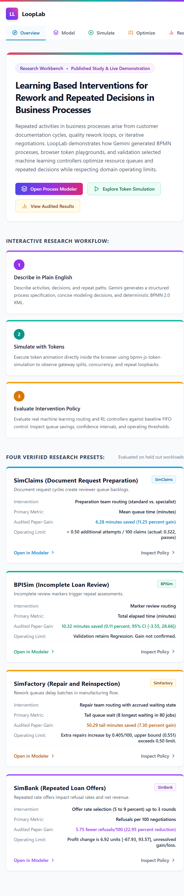
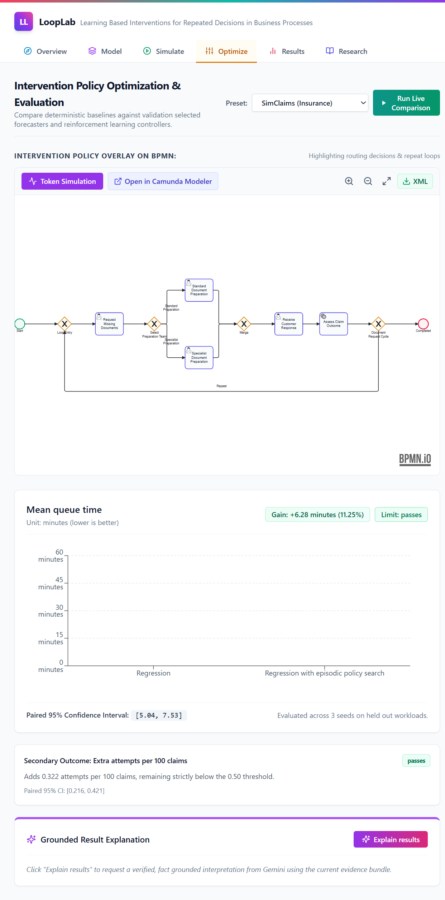
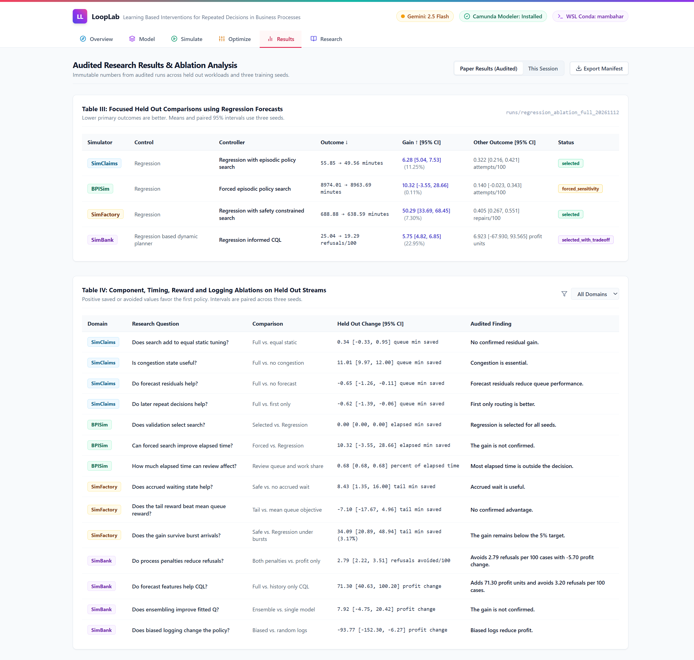

# Visual Walkthrough and User Interface Guide:

This document describes the visual structure, branding identity, page by page interface workings, and responsive layouts of the LoopLab research workbench.

## Visual Identity and Brand Logo:

- Logo Design:
  The LoopLab logo consists of two circular loop arrows arranged in a circle pointing to each other in a continuous clockwise loop. The upper arrow is colored in purple (#8B5CF6) and the lower arrow is colored in green (#10B981). Both arrows sit centered on a crisp white circular background bordered by a subtle outline.
  Component reference: [LoopLabLogo.tsx](web/components/workspace/LoopLabLogo.tsx).

- Rainbow Color Spectrum Theme:
  The interface employs a vibrant multi color rainbow spectrum to separate functional stages, status indicators, and research domains without visual monotony.
  - Rainbow spectrum accent stripe runs along the very top of the navigation header across all pages.
  - Overview stage uses sky blue accents.
  - Model page uses purple and violet accents.
  - Simulate page uses emerald green and teal accents.
  - Optimize page uses amber and gold accents.
  - Results page uses rose and pink accents.
  - Research page uses indigo and cyan accents.

- Semantic BPMN Canvas Colors:
  The diagram rendering canvas automatically applies semantic colors to OMG BPMN 2.0 elements:
  - Start events: Emerald green border (#059669) with light mint fill (#ecfdf5).
  - Gateways: Warm amber diamond border (#d97706) with soft cream fill (#fffbeb).
  - User and service tasks: Royal indigo border (#4f46e5), rounded corners (rx=8px), and light slate fill (#f8fafc).
  - End events: Crimson rose border (#e11d48) with soft rose fill (#fff1f2).
  - Repeat return flows: Dotted purple path (#8b5cf6) routing backward underneath the main flow.

## Page by Page Visual Walkthrough:

### 1. Overview Page (`/`):

- Header Banner:
  Features the circular dual arrow loop logo, system title, and live environment indicator chips for Gemini 2.5 Flash and Camunda Modeler.
- Hero Orientation Section:
  Presents the core research claim, title, and three direct action buttons: Open Process Modeler (gradient purple pink button), Explore Token Simulation (emerald button), and View Audited Results (amber button).
- Interactive Research Workflow:
  Three numbered cards outline the user progression:
  - Step 1 (Purple card): Describe in Plain English.
  - Step 2 (Teal card): Simulate with Tokens.
  - Step 3 (Amber card): Evaluate Intervention Policy.
- Four Verified Research Presets:
  Grid of four interactive cards summarizing SimClaims (Sky blue), BPISim (Emerald green), SimFactory (Amber), and SimBank (Purple) with intervention points, primary metrics, audited gains, and full operating limit text.

### 2. Process Modeler and Compiler Page (`/model`):

- Left Column (Prompt and Refinement):
  - Starter Examples picker dropdown allowing instantaneous loading of SimClaims, BPISim, SimFactory, SimBank, or Parallel verification models.
  - Natural Language Description textarea with Gemini 2.5 Flash badge and vibrant gradient generation button.
  - Plain English Refinement input with teal action button enabling iterative prompt adjustments without resetting.
- Center Column (Wide BPMN Canvas):
  - Clean horizontal diagram layout flowing from left to right with no overlapping tool palette.
  - Controls toolbar with Token Simulation toggle, Open in Camunda Modeler launcher, zoom in, zoom out, fit to screen, and XML download.
- Right Column (Model Inspector):
  - Tabbed inspector with Rationale, Assumptions, and Validation tabs.
  - Decision cards featuring colored left accent borders, decision identifiers, justifications, cited input text, and interactive node highlight buttons.

### 3. Simulation and Execution Playground (`/simulate`):

- Mode Selector:
  Three view tabs styled with signature rainbow pills:
  - Browser Token Playback: Indigo pill.
  - Research Workload Trace: Emerald pill.
  - Camunda 8 Engine: Purple pill.
- Workload Queue Simulation:
  - Domain selector dropdown.
  - Emerald button triggering 15 case simulation replay through the Python research service.
  - Live metric summary displaying baseline mean queue versus candidate policy mean queue.
  - Chronological event trace drawer detailing attempts, timestamps, service durations, and routing actions.
- Camunda 8 Gateway Drawer:
  - Status indicators confirming local desktop Modeler installation.
  - Step by step preparation and deployment workflow.
  - Direct desktop application launch button.

### 4. Intervention Policy Optimization Page (`/optimize`):

- Left Column:
  Horizontal BPMN diagram with policy overlay highlighting controlled decision gateways and repeat loops.
- Right Column:
  - Comparison Bar Chart rendering baseline control in royal indigo (#4f46e5) and learned policy candidate in crimson rose (#e11d48).
  - Gain badge with percentage improvement and operating limit pass status.
  - Paired 95 percent confidence interval display across evaluation seeds.
  - Grounded Result Explanation card with fuchsia action button. Gemini 2.5 Flash outputs verified key findings, operating limits, and uncertainty bounds with all floating point numbers rounded to two decimal places.

### 5. Audited Research Results Page (`/results`):

- Origin Switcher:
  Allows toggling between audited paper results and current session runs.
- Table III (Focused Comparisons):
  Full reproduction of paper Table III across SimClaims, BPISim, SimFactory, and SimBank with colored simulator badges, controls, candidates, outcomes, gains, paired confidence intervals, and selection status pills.
- Table IV (Component and Timing Ablations):
  Twelve ablation rows covering research questions, comparisons, held out changes, and audited findings with individual domain color pills and domain filter dropdown.

### 6. Research Documentation Page (`/research`):

- Four Simulation Environment Cards:
  Cards featuring distinct top color bars (Sky, Emerald, Amber, Purple) detailing setting, decision point, outcomes, mechanism, and constraints.
- Data Provenance and Rights Section:
  Teal bordered section documenting DOIs and licensing for Mendeley Data, 4TU.ResearchData, and BPI Challenge 2017 event logs.
- Evaluation Rigor Protocol:
  Indigo bordered card recording master random seed generation, held out workload splits, common random numbers, and reporting standards.

## Responsive Viewport Visual Verification:

### Mobile Layout (390px by 844px):

- Header navigation tabs scroll smoothly along the horizontal axis with full touch targets.
- Hero call to action buttons stack vertically for thumb friendly tapping.
- Domain cards and workflow steps collapse into single column vertical cards.
- Viewport width maintains strict containment with zero horizontal document overflow.

### Tablet Layout (768px by 1024px):

- Canvas expands to occupy full tablet width, centering horizontal BPMN elements.
- Comparison charts, secondary metric cards, and result explanation drawers stack cleanly below the diagram.

### Widescreen Desktop Layout (1920px by 1080px):

- Maximum container bounds prevent visual stretching on high resolution monitors.
- Full width data tables display complete columns, numerical intervals, and status badges with balanced whitespace.

## Screenshot File Index:

All full resolution screenshots captured during visual audits are stored in the project repository using relative paths:

- Overview desktop: [screenshots/overview_desktop.png](screenshots/overview_desktop.png).
- Process modeler desktop: [screenshots/model_desktop.png](screenshots/model_desktop.png).
- Workload simulation trace: [screenshots/simulate_trace.png](screenshots/simulate_trace.png).
- Policy optimization and explanation: [screenshots/optimize_explanation.png](screenshots/optimize_explanation.png).
- Results table desktop: [screenshots/results_desktop.png](screenshots/results_desktop.png).
- Research documentation desktop: [screenshots/research_desktop.png](screenshots/research_desktop.png).
- Mobile overview layout: [screenshots/overview_mobile.png](screenshots/overview_mobile.png).
- Tablet optimize layout: [screenshots/optimize_tablet.png](screenshots/optimize_tablet.png).
- Widescreen results layout: [screenshots/results_widescreen.png](screenshots/results_widescreen.png).
